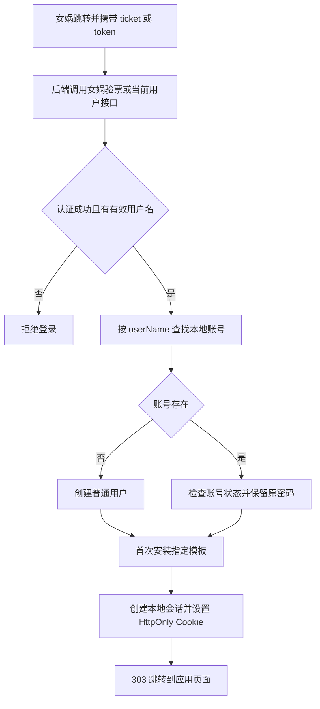

# 女娲 SSO 与智能体模板同步：评审、实现及合并记录

日期：2026-11-09（Asia/Shanghai）。

本次工作从 [PR #1](https://github.com/skylinewx/agentscope/pull/1) 的可合并性评审开始，
经过需求确认、代码修复、隔离自测和真实来源只读检查，最终纳入本地 `dev`。
运维配置和用户操作见 [女娲 SSO 与智能体模板](NVWA_SSO.md)。

## 1. 背景与处理范围

最初审查的 PR 提交为 `56043fd851ab4e67307eb7154e6032e28e3c54f2`。
该 PR 增加女娲登录、即时创建本地用户、智能体初始化，以及 `/agentscope/`
子路径嵌入界面。原实现存在身份绕过、凭据复制和兼容性问题，因此先修复再合并。

本次修复分支为 `codex/fix-nvwa-sso`，目标为 `dev`。合并前核对的
`dev` / `origin/dev` 均为 `87a883f44d37d727036cbee88aadf55dddb76a46`。
两支共同祖先为 `1ffa19b00cc7bb777d67241a121bb40a070ed2c2`，不是简单快进关系。
`dev` 已有预算查询、本体契约和调用日志提交，需要一并保留。

本次范围包括认证入口、首次模板安装、手动更新、资源授权、前端交互、部署示例、
回归测试及文档；真实女娲接口及业务 MCP 联调另有前置条件，见第 8 节。

## 2. 需求确认与最终决策

| 讨论项 | 最终决策 | 行为与边界 |
| --- | --- | --- |
| 本地账号匹配 | 沿用简化的 `userName` 映射 | 只使用服务端验票返回的用户名，不区分大小写；不引入外部用户 ID 绑定表 |
| 登录方式 | 保留用户名密码，额外增加女娲 SSO | 删除 URL 用户名认证回退，不删除 `/auth/login` |
| 新用户 | 自动创建普通用户 | 随机生成本地密码；以后要密码登录，由管理员设置密码 |
| 已有普通用户 | 继续使用原账号 | 保留 ID、密码和已有业务数据；停用或删除状态不会被 SSO 恢复 |
| 内置 admin | 使用用户名密码登录 | 拒绝女娲同名账号直接登录本地 admin |
| 来源选择 | 服务端固定 `owner_id` 与 `agent_id` | 不按名称模糊查找，不遍历复制源账号所有智能体或凭据 |
| 更新方式 | 首次同步，以后用户按需点击更新 | 重复登录不自动覆盖；更新前先预览，冲突默认保留个人修改 |
| 测试来源 | `wx` 下的“本体测试1011” | 用户提供编辑页地址后，校正了最初的 admin 来源假设 |

用户提供的地址片段：

```text
5fa05c82019c465794aee1ffa53a3131?owner=wx
```

解析结果为：

```json
{
  "template_owner_id": "wx",
  "template_agent_id": "5fa05c82019c465794aee1ffa53a3131"
}
```

来源通过只读访问确认，包含默认模型、3 个 Skill 和 1 个 Streamable HTTP MCP。
三个 Skill 的名称均被来源提示词引用，因此实现保留这些名称及完整安装包。
上述来源配置已写入本机被 Git 忽略的 `service-config.local.json`；其他部署需自行配置。

## 3. 原 PR 的问题与处理

| 问题 | 原行为或影响 | 最终处理 |
| --- | --- | --- |
| URL 用户名认证绕过 | 仅传用户名可能登录为其他用户，甚至 admin | 必须携带 ticket/token 并通过服务端验票；URL 用户名不能认证 |
| 未验证 JWT 回退 | 上游异常时解码 JWT 声明作为身份，可接受伪造或过期声明 | 移除回退；HTTP、业务码、JSON 或用户信息异常均拒绝登录 |
| 复制管理员凭据 | 将源账号模型密钥变为新用户自有凭据，可从自有凭据接口读出 | 改为使用来源引用的模型凭据和知识库，不复制密钥，不赋予编辑权限 |
| 跳转注入 | 将 `next` 拼入内联脚本可能导致脚本注入 | 校验应用内路径，使用 303 跳转及 HttpOnly Cookie，移除内联令牌脚本 |
| 部署子路径不一致 | 页面在 `/agentscope/`，请求仍发往根 `/api/` | API、登录跳转、Vite 代理、Cookie 路径按公开路径统一配置 |
| Header 会话退出异常 | 仅有会话请求头时，退出代码仍直接取 Cookie | 从认证中间件读取已认证令牌，按配置的 Cookie 路径删除 |
| 会话继承回归 | 无权限的模型或知识库默认值被静默丢弃 | 恢复显式权限校验；SSO 所需权限由模板策略单独提供 |

初轮对照回归定位了 4 个继承配置失败案例。恢复原权限语义后，这些用例在最终
回归中通过。普通智能体复制功能保持既有行为；SSO 初始化走独立模板服务。

## 4. 最终实现

### 4.1 认证与账号创建



`auth_mode=auto` 根据入口参数选择 bearer 查询或短 ticket 换票，也可由服务端
固定模式。用户名仅来自成功的上游响应；上游不可用不会降低认证要求。
普通密码登录继续工作。Cookie 使用配置的公开路径，响应禁止缓存；成功跳转
设置不发送 Referer，避免携带登录参数继续导航。

### 4.2 首次模板安装

`AgentTemplateService` 按用户及来源生成稳定 ID，并在锁内检查是否已经安装。
首次安装复制名称、简介、系统提示词、运行配置、默认模型选择、记忆配置和资源绑定。
Skill 固定到完整安装包版本；MCP 创建独立资源记录，但移除静态请求头及来源参数值。

智能体、资源记录、绑定和工作空间彼此隔离。Skill 的不可变内容可使用相同内容哈希，
运行时安装副本独立。初始操作权限采用默认值，不继承来源的宽松操作权限。
不复制来源聊天记录、工作文件、记忆内容或业务 token。

首次安装失败回滚新建资源，可通过重新登录重试；同名个人资源会返回冲突，
要求先重命名，不覆盖用户已有资源。来源所有者登录时直接沿用已有来源智能体。
已安装用户后续登录不要求来源仍存在；来源删除仍可能影响资源授权和检查更新。

### 4.3 手动更新及冲突处理

智能体编辑页新增“检查更新”。有未保存草稿时按钮禁用；弹窗显示差异和冲突项。
用“上次来源快照、当前个人配置、当前来源配置”三者比较：

| 情况 | 更新结果 |
| --- | --- |
| 来源未变、用户已改 | 保留用户修改 |
| 来源已变、用户未改 | 应用来源更新 |
| 双方改成同一个值 | 不产生冲突 |
| 双方改成不同值 | 默认保留个人值；用户可逐项勾选采用来源值 |
| 预览后来源或个人配置又变化 | 返回冲突，要求重新检查 |
| 工作空间有运行中的会话 | 拒绝本次更新，稍后再试 |

更新保留工作空间 ID、历史会话、工作文件和长期记忆内容。继承默认配置的已有
会话会使用更新后的默认值；会话单独设置的模型保持不变。来源移除绑定后，更新
不主动清空用户资源库或删除工作文件。手动复制智能体时不继承模板同步身份。

### 4.4 模型、知识库和业务 MCP

模板授权策略只向已通过女娲认证的活跃用户提供来源智能体实际引用的模型凭据、
知识库的使用权限；与既有授权策略组合，不增加来源资源的编辑权限。
来源移除引用时授权随之撤销，用户无法读取源账号其他未引用凭据。

模型调用仍使用来源凭据对应的计费账户。知识库内容和模型密钥是共享引用：
其内容更新或密钥轮换可立即影响使用，不受智能体“手动更新”开关控制。
手动更新控制的是智能体配置及安装包版本，不承诺将外部共享服务冻结为旧版本。

业务 MCP 使用当前用户经验证的女娲业务 token。该 token 保存在独立认证 Redis
键中，有有效期和账号版本校验，不进入智能体、资源配置或 API 输出。短 ticket
本身不当作业务 token，须由女娲明确返回业务凭证或使用验证过的 bearer 登录。

仅支持 Streamable HTTP 模板 MCP。注入前复核来源绑定、目标地址及获准配置；
用户修改地址后不会继续向新地址转发业务 token。token 轮换会更换对应运行客户端，
缺失、失效、登出或账号版本变化后不能建立新的获授权调用。现有长调用还受上游
凭证校验约束。静态 headers、STDIO、旧 SSE 及带查询参数的 MCP URL 不自动迁移。

## 5. 主要代码位置

| 模块 | 文件 | 作用 |
| --- | --- | --- |
| 女娲验票 | `src/agentscope/app/auth/_nvwa_ticket.py` | 上游请求、响应验证、来源和 token 配置 |
| 登录与会话 | `src/agentscope/app/auth/_http.py`、`_service.py`、`_store.py` | 账号映射、Cookie/重定向、退出、私有业务 token |
| 模板服务 | `src/agentscope/app/_service/_agent_template.py` | 来源快照、首次安装、三方比较、授权与 MCP 注入校验 |
| 更新接口 | `src/agentscope/app/_router/_agent_management.py` | `template-preview`、`template-update` |
| 智能体记录 | `src/agentscope/app/storage/_model/_agent.py` | 服务端同步来源和基线元数据 |
| MCP 运行 | `src/agentscope/app/_service/_resources.py` | 注入运行时请求头、客户端轮换及错误脱敏 |
| 页面 | `examples/web_ui/frontend/src/pages/agents/TemplateUpdateDialog.tsx` | 预览、冲突选择和确认更新 |
| 子路径 | `examples/web_ui/frontend/src/lib/public-path.ts`、`src/api/client.ts`、`vite.config.ts` | 统一 API 与页面前缀 |
| 部署 | `examples/agent_service/service_config.py`、`service-config.example.json`、`examples/web_ui/nginx.agentscope-under-nvwa.conf.example` | 配置入口和代理示例 |

旧的 SSO 智能体批量初始化、凭据复制模块 `_sso_bootstrap.py` 和
`_sso_credentials.py` 已删除。安装配置保存在现有记录载荷中，不新增独立 SQL 表。

## 6. 自测过程与结果

修复分支最终自测：**210 项测试通过，57 个子用例通过**。模板用例分别覆盖
fakeredis 和 SQLite 后端；使用隔离目录、模拟验票和假 MCP，不调用真实付费模型。

合并到 `dev` 的代码上重新执行并补充调用日志、MCP 运行时请求头、分析启动、预算
适配/批量查询与智能体契约用例：**283 项测试通过，81 个子用例通过**，耗时约
119 秒。合并后的前端 TypeScript/Vite 构建及本次修改文件 ESLint 检查通过。

| 验证层面 | 覆盖内容 | 结果 |
| --- | --- | --- |
| 认证 | 合法验票、伪造/过期 JWT 拒绝、上游异常、跳转校验、admin 保护、Header 退出 | 通过 |
| 账号 | 并发按用户名匹配、密码保留、停用账号拒绝 | 通过 |
| 模板 | 首次安装、幂等、两用户隔离、完整 Skill、名称保留、同名冲突与失败回滚 | 通过 |
| 更新 | 无自动覆盖、冲突保留与明确替换、过期预览拒绝、运行中拒绝、会话独立配置保留 | 通过 |
| 凭据 | 不复制来源密钥、未引用凭据不可见、预览脱敏、来源授权撤销、MCP 地址变更拒绝 | 通过 |
| 运行时 token | 注入、轮换、失效、登出后不可用、序列化不含 token | 通过 |
| 既有功能 | 密码认证、滚动续期、配置读取、智能体管理、资源解析和路由 | 通过 |
| 前端 | TypeScript/Vite 构建、本次修改文件 ESLint | 通过 |
| 浏览器 | Cookie 登录、子路径请求、冲突默认值、更新确认、取消及焦点返回、草稿保护、深浅主题和窄屏 | 通过，无页面脚本异常 |
| 真实来源 | 指定 ID、3 个 Skill 安装包、1 个 HTTP MCP、提示词保留 | 只读检查通过 |

合并后完整后端回归命令（仓库根目录，Python 环境需包含项目与测试依赖）：

```powershell
$env:PYTHONPATH = Join-Path (Get-Location) 'src'
$env:PYTHONUTF8 = '1'
python -m pytest `
  tests/app_auth_nvwa_ticket_test.py tests/app_auth_sso_nvwa_test.py `
  tests/app_agent_template_test.py tests/user_auth_test.py `
  tests/auth_sliding_session_test.py tests/service_config_test.py `
  tests/shared_agent_defaults_test.py tests/agent_management_test.py `
  tests/service_resources_test.py tests/resource_access_policy_test.py `
  tests/resource_resolution_test.py tests/resource_router_test.py `
  tests/call_io_test.py tests/mcp_runtime_headers_test.py `
  tests/analysis_bootstrap_test.py tests/analysis_budget_adapter_test.py `
  tests/analysis_budget_batch_test.py tests/analysis_agent_contracts_test.py `
  -q --tb=short -o asyncio_default_fixture_loop_scope=function
```

本次受限本机环境将 pytest 依赖和临时目录放在 `.cache/pr-review-1/`，并追加到
`PYTHONPATH` / `TEMP` / `TMP`；这些依赖、临时数据、浏览器脚本和截图不纳入提交。
浏览器测试通过仅监听本机的模拟服务运行，最终关闭测试进程。

前端在 `examples/web_ui/frontend` 执行：

```powershell
$env:VITE_PUBLIC_BASE_PATH = '/agentscope/'
npm.cmd run build
```

构建有现有的大文件分包、动态导入和浏览器兼容提示，构建退出成功。本次没有把
这些提示当作 SSO 阻塞项，也没有为其修改无关打包逻辑。

## 7. 合并策略与变更影响

先在修复分支提交实现、测试和文档，再将完整分支合并到本地 `dev`，保留 PR 原有
嵌入界面功能及 `dev` 的预算查询、调用日志等既有提交。合并结果需检查冲突标记、
重跑认证/模板/资源回归，并验证前端构建。实际提交关系以 Git 历史为准，避免在
文档中写入尚未生成的本次提交哈希。

本次实现提交为 `47332362`。实际合并仅在 `examples/agent_service/README.md`
发生内容冲突，处理时同时保留 `dev` 的调用日志说明和新增 SSO 文档入口。
`main.py` 自动合并后同时保留调用日志初始化和女娲配置注入；预算查询等既有
`dev` 提交继续保留。合并完成后工作分支为本地 `dev`，远端推送与部署另行执行。
合并检查还修正了原 PR 遗留的中英文无模型提示：不再建议重新登录来“同步管理员
凭证”，改为添加个人模型凭证或联系管理员开通使用权限，与最终授权方式一致。

密码登录入口和已有密码继续有效。新 SSO 账号或既有普通账号的首次 SSO 会安装
指定模板；之后来源配置变更需手动检查更新。管理者应留意共享模型费用和共享
知识库内容可见性。模板源必须来自可信账号，且保持配置中的 owner/agent ID 对应。

本机来源配置文件被 Git 忽略，不会随着代码合并自动部署到其他环境。多进程部署
应使用共享 `RedisMessageBus`；前端公开路径、API 代理和 Cookie 路径必须匹配。

若需要停用新 SSO 入口，可移除或清空女娲服务地址配置并重启，保留普通密码登录；
依赖女娲业务 token 或模板共享授权的功能会相应不可用。停用入口不会自动撤销
已签发的本地会话，也不会清理已创建的用户和智能体；应按需通过账号管理撤销。

## 8. 待完成的真实环境联调

截至本次记录，本机未配置 `nvwa.base_url`。因此以下内容不能视为已验证：

1. 真实女娲服务地址、接口路径、业务码及 `userName` 返回结构。
2. 短 ticket 是否返回可用于业务 MCP 的 `accessToken`，或真实 bearer 登录是否可用。
3. 普通用户从女娲进入、首次安装、模型实际响应及 MCP 的用户权限。
4. 实际网关、HTTPS/Cookie、有效期和退出后的业务表现。

这些事项属于部署联调前置检查，不能用模拟验票、只读来源校验或代码合并代替。
本次合并不部署、不调用真实业务模型，也不更新真实用户数据。
